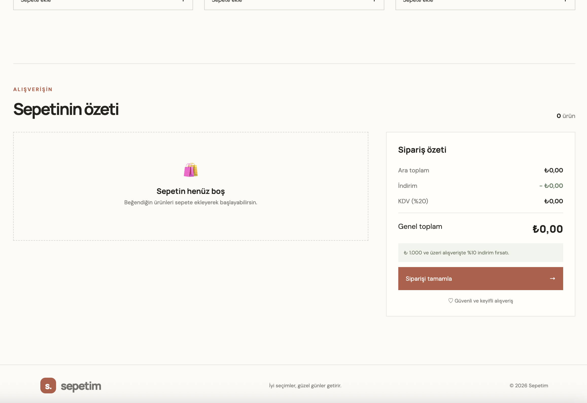

# 🛒 Sepetim – JavaScript Hata Ayıklama Projesi

HTML, CSS ve JavaScript kullanılarak hazırlanmış mini bir alışveriş sepeti uygulamasıdır.

Projenin HTML ve CSS tasarımı hazırdır. Ancak `js/app.js` dosyasında bilerek bırakılmış JavaScript hataları bulunmaktadır.

**Görevin:** Mevcut kodları incelemek, hataları tespit etmek, nedenlerini anlamak ve JavaScript kodlarını adım adım düzelterek uygulamayı çalışır hâle getirmek.

> ⚠️ HTML ve CSS dosyalarını istersen inceleyebilir, tasarım üzerinde değişiklik yapabilirsin. Ancak bu çalışmanın asıl amacı JavaScript pratiği yapmaktır. Bu nedenle JavaScript kısmını baştan yazmadan, adım adım ilerlemeni istiyorum.

---

## 🎯 Projenin Amacı

Bu proje ile aşağıdaki JavaScript konularını pekiştirmen hedeflenmektedir:

- `var`, `let`, `const` kullanımı
- Veri türleri (`string`, `number`) ve tür dönüşümleri
- Operatörler (`=`, `===`, `>`, `>=`)
- Array metotları:
  - `find()`
  - `filter()`
  - `map()`
  - `reduce()`
- DOM seçimi ve `dataset` kullanımı
- Olay dinleyicileri (`addEventListener`)
- Fonksiyonlar ve koşullu ifadeler
- Konsol hata mesajlarını okuma
- JavaScript hata ayıklama (Debugging)

## ✨ Uygulama Özellikleri

Uygulamanın çalışır hâle getirildiğinde desteklemesi gereken özellikler:

- Ürünleri sepete ekleme
- Aynı ürünü tekrar eklediğinde ürün adedini artırma
- `+` ve `−` butonlarıyla ürün adedini değiştirme
- Ürünleri sepetten silme
- Ara toplam hesaplama
- İndirim hesaplama
- KDV hesaplama
- Genel toplam hesaplama
- Sepet boşken sipariş tamamlamayı engelleme
- Mobil uyumlu (responsive) tasarım

## 📁 Proje Yapısı

```text
sepetim/
│
├── index.html
│
├── css/
│   └── style.css
│
├── js/
│   └── app.js
│
├── images/
│   ├── ekran-1.png
│   └── ekran-2.png
│
├── GOREV.md
├── GOREV-KOD-OKUMA.md
└── README.md
```

| Dosya | Açıklama |
|---|---|
| `index.html` | Hazır HTML sayfa yapısı |
| `css/style.css` | Hazır CSS tasarımı |
| `js/app.js` | Hataları bulup düzelteceğin JavaScript dosyası |
| `GOREV.md` | Görevler ve test senaryoları |
| `GOREV-KOD-OKUMA.md` | Kod okuma ve analiz soruları |
| `README.md` | Proje açıklaması |

## 🚀 Projeyi Çalıştırma

### 1. Projeyi bilgisayarına indir

Terminali aç ve aşağıdaki komutu çalıştır:

```bash
git clone https://github.com/goknurgurz/JavaScript-Wrong-Basic-Project1.git
```

### 2. Projeyi VS Code ile aç

İndirdiğin proje klasörünü Visual Studio Code ile aç.

### 3. Uygulamayı çalıştır

`index.html` dosyasını tarayıcıda açabilirsin.

İstersen VS Code içerisindeki Live Server eklentisini de kullanabilirsin.

### 4. Console ekranını aç

Tarayıcıda `F12` tuşuna basarak Developer Tools ekranını aç.

Ardından **Console** sekmesine geç.

JavaScript hatalarını ve konsol mesajlarını buradan takip edeceksin.

> Herhangi bir paket yüklemesi veya kurulum gerekmemektedir.

---

## 📋 Yapman Gerekenler

Bu projede senden beklediğim, kodları doğrudan değiştirerek sonuca ulaşman değil; hataları anlayarak çözmen.

Aşağıdaki adımları sırasıyla tamamla:

1. **Uygulamayı test et:** Hiçbir kodu değiştirmeden projeyi çalıştır. Çalışmayan özellikleri ve karşılaştığın hataları not al.
2. **JavaScript kodlarını incele:** `js/app.js` dosyasını baştan sona oku. Fonksiyonların ne yaptığını anlamaya çalış.
3. **Kod okuma sorularını cevapla:** `GOREV-KOD-OKUMA.md` dosyasındaki soruları kendi cümlelerinle cevapla.
4. **Hataları tespit et:** Kod içerisindeki yanlış değişken kullanımlarını, operatör hatalarını, DOM seçimlerini ve mantık hatalarını bul.
5. **Adım adım düzelt:** Her seferinde bir hatayı düzelt. Sayfayı yenile ve ilgili özelliği tekrar test et.
6. **Test senaryolarını tamamla:** `GOREV.md` dosyasındaki bütün senaryoları uygula.
7. **GitHub'a yükle:** Düzelttiğin projeyi kendi GitHub hesabına yükle.

**Önemli:** Kodu baştan yazma ve çözümü internetten kopyalama. Her düzeltmeden sonra kendine şu soruyu sor:

*Bu kod neden hatalıydı ve ben neden bu şekilde düzelttim?*

Amacımız yalnızca çalışan bir uygulama ortaya çıkarmak değil, yazdığın JavaScript kodunun mantığını anlayabilmek.

---

## 💰 İş Kuralları

Sepet hesaplamalarında aşağıdaki kuralları kullanmalısın:

| İşlem | Değer |
|---|---:|
| İndirim eşiği | 1.000 TL ve üzeri |
| İndirim oranı | %10 |
| KDV oranı | %20 |
| KDV hesabı | İndirim sonrası tutar × %20 |
| Genel toplam | İndirim sonrası tutar + KDV |

**Hesaplama sırası:**

1. Sepetteki ürünlerin fiyat ve adetlerini hesaplayarak ara toplamı bul.
2. Ara toplam 1.000 TL veya üzerindeyse %10 indirim uygula.
3. İndirim tutarını ara toplamdan çıkar.
4. İndirim sonrası tutar üzerinden %20 KDV hesapla.
5. KDV'yi ekleyerek genel toplamı bul.

## ✅ Test Senaryoları

Aşağıdaki senaryoları uygulayarak sepetin doğru çalışıp çalışmadığını kontrol et.

| Test | Beklenen Sonuç |
|---|---|
| Yalnızca Seramik Kupa ekle | Ara toplam: 289 TL |
| Seramik Kupa'yı iki kez ekle | Tek satır, adet: 2, ara toplam: 578 TL |
| Günlük Defter + Vanilya Mum ekle | Ara toplam: 778 TL, indirim yok |
| Üç üründen birer tane ekle | Ara toplam: 1.067 TL, indirim: 106,70 TL |
| Üç üründen birer tane ekle | KDV: 192,06 TL, genel toplam: 1.152,36 TL |
| Bir ürünü sil | Yalnızca seçilen ürün kaldırılır |
| Sepetteki son ürünü azalt | Boş sepet mesajı görünür |
| Sepet boşken siparişi tamamla | Uyarı gösterilir, sipariş oluşturulmaz |

## 📤 Teslim Edilecekler

Projeyi tamamlarken aşağıdaki çıktıları hazırlamalısın:

- [ ] Düzeltilmiş proje dosyaları
- [ ] `GOREV-KOD-OKUMA.md` içerisindeki soruların cevapları
- [ ] GitHub repo bağlantısı
- [ ] En az 3 ekran görüntüsü:
  - Ürünlerin listelendiği ana sayfa
  - Ürünlerin sepete eklendiği dolu sepet
  - İndirim uygulanmış sipariş özeti

Ekran görüntülerini README dosyana da ekleyebilirsin.

## 🖼️ Uygulama Ekran Görüntüleri

### Ürün Listesi


### Sepet ve Sipariş Özeti



---

## 📝 Son Not

Bu proje eğitim amacıyla hazırlanmıştır. JavaScript kodlarının içerisine bilerek hatalar yerleştirilmiştir.

Gerçek bir geliştirici gibi düşünmeni, hataları araştırmanı, Console ekranını kullanmanı ve her düzeltmenin arkasındaki mantığı anlamanı istiyorum.

**Unutma: Kod yazmak kadar, yazdığın kodun neden çalışmadığını anlayabilmek de yazılım geliştirmenin önemli bir parçasıdır.**

Başarılar! 🚀

---

**Proje:** JavaScript-Wrong-Basic-Project1  
**Konu:** JavaScript Hata Ayıklama (Debugging)  
**Seviye:** Başlangıç  
**Teknolojiler:** HTML5, CSS3, JavaScript
